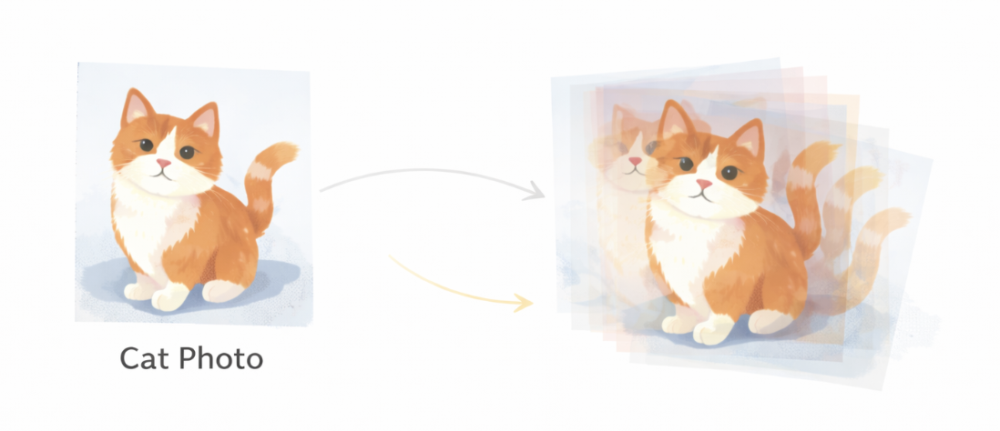
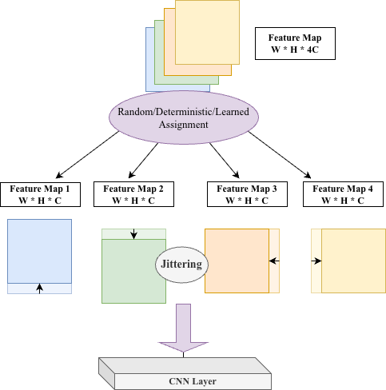
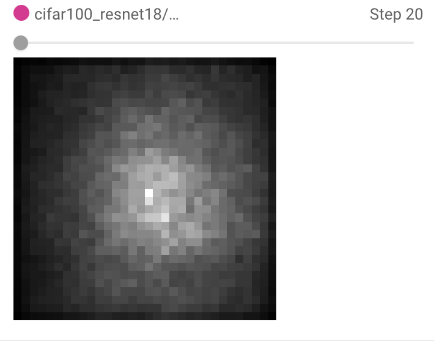
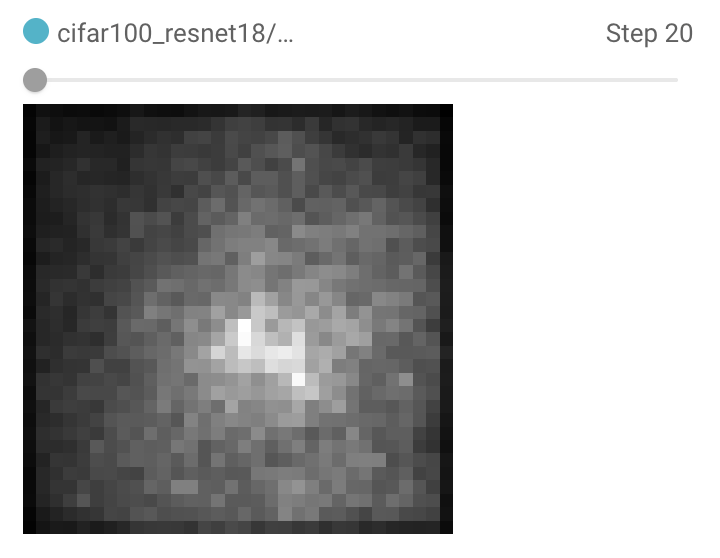

# Expanding CNN receptive fields with feature-map shifts

This repository contains my shift-operation experiments from the [KUBIG Beyond CNN team project](https://github.com/KU-BIG/KUBIG_2025_FALL/tree/main/KUBIG%20CONFERENCE/Beyond%20CNN%201%ED%8C%80%28%5E%5E%29). The team explored ways to give CNNs wider spatial context while retaining their convolutional structure. My experiments used ResNet-18 on CIFAR-100.

## Motivation

A small convolution kernel processes nearby positions. Shifting intermediate feature maps before a convolution lets the same kernel receive information from other positions without enlarging the kernel or adding attention.



*The motivating idea from my KUBIG presentation: shift features before local convolution.*

## My contribution

- Implemented **deterministic channel-group shifts**, **random shifts**, **subpixel shifts with interpolation**, and **learnable soft shifts**.
- Inserted each operator into the same ResNet-18 backbone and held the remaining architecture and training setup fixed for comparison.
- Compared classification accuracy and visualized the **effective receptive field (ERF)** at a fixed output position.



*Shift-operation diagram from my KUBIG presentation.*

## Results

The presentation reports CIFAR-100 test accuracy over four seeds after 120 epochs:

| Operator | Mean accuracy (%) | SD |
| --- | ---: | ---: |
| No shift | **77.62** | 0.16 |
| Deterministic shift | 77.18 | 0.24 |
| Learnable shift | 77.01 | 0.21 |
| 0.5-pixel shift | 76.65 | 0.31 |
| Random 1-pixel shift | 76.17 | 0.21 |

At epoch 20, the shifted models showed a wider measured ERF:

| No shift | Deterministic shift | Learnable shift |
| :---: | :---: | :---: |
|  |  |  |

*ERF visualizations from my KUBIG presentation; shown at the same training epoch.*

## Discussion

The shifts widened the measured ERF but did not improve classification accuracy in these experiments. A wider ERF alone was therefore insufficient under this setup. These findings describe my shift variants; the [team project](https://github.com/KU-BIG/KUBIG_2025_FALL/tree/main/KUBIG%20CONFERENCE/Beyond%20CNN%201%ED%8C%80%28%5E%5E%29) also explored other approaches.

## Code and usage

| File | Role |
| --- | --- |
| [`operators.py`](operators.py) | Shift operators and interpolation |
| [`model.py`](model.py) | ResNet-18 with operator selection |
| [`train.py`](train.py) | Training and experiment entry point |
| [`evaluation.py`](evaluation.py) | Accuracy and ERF measurement |
| [`notebooks/ConvJitter.ipynb`](notebooks/ConvJitter.ipynb) | Original experiment sequence |

Install the packages in [`requirements.txt`](requirements.txt), then run, for example:

```bash
python train.py --variant baseline --seed 8
python train.py --variant shift_det --seed 8
python train.py --variant shift_learnable --seed 8
```

CIFAR-100 is downloaded through `torchvision`. Checkpoints and datasets are generated locally and are not included here.
