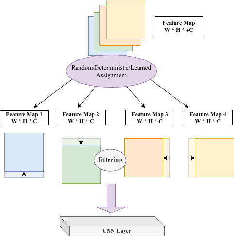
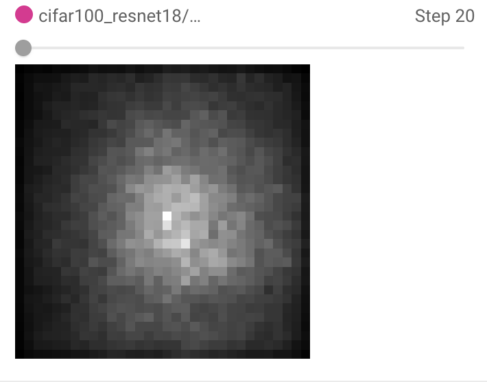
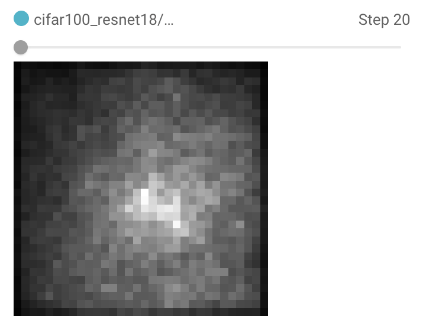

# Expanding CNN receptive fields with feature-map shifts

This repository contains my shift-operation experiments from the [KUBIG Beyond CNN team project](https://github.com/KU-BIG/KUBIG_2025_FALL/tree/main/KUBIG%20CONFERENCE/Beyond%20CNN%201%ED%8C%80%28%5E%5E%29). For more information about the project, see the team repository.

## Motivation

- Shifting feature maps could widen the effective receptive field without larger convolution kernels or attention, while adding little additional computation.
- Random shifts could also act as feature-map-level augmentation and encourage more robust representations.


*The motivating idea from my KUBIG presentation: shift features before local convolution.*

## My contribution

- Implemented **deterministic shifts**, **random shifts**, **fractional shifts**, and **learnable shifts**.
- The **random and deterministic shifts** assigned channels to shift directions randomly or by channel index, while the **learnable variant** combined shifted and unshifted feature maps using learned weights.
- Inserted each operator into the same ResNet-18 backbone and held the remaining architecture and training setup fixed for comparison.
- Compared classification accuracy and visualized the **effective receptive field (ERF)** at a fixed output position.



*Shift-operation diagram from my KUBIG presentation.*

## Results

CIFAR-100 test accuracy after 120 epochs across four seeds:

| Operator | Mean accuracy (%) | SD |
| --- | ---: | ---: |
| No shift | **77.62** | 0.16 |
| Deterministic shift | 77.18 | 0.24 |
| Learnable shift | 77.01 | 0.21 |
| fractional shift | 76.65 | 0.31 |
| Random shift | 76.17 | 0.21 |

At epoch 20, the shifted models showed a wider measured ERF:

| No shift | Deterministic shift | Learnable shift |
| :---: | :---: | :---: |
|  |  |  |

*ERF visualizations from my KUBIG presentation, shown at the same training epoch.*

The shifts widened the measured ERF but did not improve classification accuracy in these experiments. The [team project](https://github.com/KU-BIG/KUBIG_2025_FALL/tree/main/KUBIG%20CONFERENCE/Beyond%20CNN%201%ED%8C%80%28%5E%5E%29) also explored other approaches, including incorporating fully connected layers and rotations.

## Interpretations

- My shift operations act as channel-wise convolutions with randomly selected, fixed, or constrained learnable kernels.
- Although the deterministic and learnable shifts preserved translation equivariance away from boundaries, their restrictions on the shift kernels introduced additional inductive biases whose benefits for the task remained unclear.
- Random shifts may destabilize training, because shift directions are selected randomly at each forward pass.
 
## Code structure

| File | Role |
| --- | --- |
| [`config.py`](config.py), [`data.py`](data.py) | Shared settings and CIFAR-100 loading |
| [`operators.py`](operators.py) | Shift operators and interpolation |
| [`model.py`](model.py) | ResNet-18 with operator selection |
| [`train.py`](train.py) | Training and experiment entry point |
| [`evaluation.py`](evaluation.py) | Accuracy and ERF measurement |
| [`notebooks/ConvJitter.ipynb`](notebooks/ConvJitter.ipynb) | Original experiment sequence |

## Running the code

Run commands from the repository root. Use a separate virtual environment:

```bash
python -m venv .venv
source .venv/bin/activate
python -m pip install -r requirements.txt
```

For interactive exploration, install `requirements-notebook.txt` instead. The
notebook now includes section headings linking each stage to its Python module.
The Python scripts expose the main workflow; the notebook also preserves optional
plots and alternative experiments. Datasets, checkpoints, and generated outputs
are not committed.

```bash
python train.py --variant baseline --seed 42
python train.py --variant shift_det --seed 42
python train.py --variant shift_learnable --seed 42
```

Other variants are `shift_int`, `shift_int_partial`, and `shift_float_05`.
Use `python train.py --help` for data, epoch, batch-size, and worker options.
CIFAR-100 downloads automatically; checkpoints go to `checkpoints/` and
TensorBoard logs to `runs/`. The notebook's final cell summarizes checkpoints
across seeds 8, 9, 10, and 42. Run each requested seed before comparing results.

The module definitions match the notebook. Random shifts also remain random
during evaluation. The recorded `best_acc` is the maximum test accuracy observed
during training, rather than an independent validation-selected final test score.
The existing experiment and reported results are preserved.

Check Python/notebook syntax and shared definitions without starting training:

```bash
python checks/check_notebook.py
```
